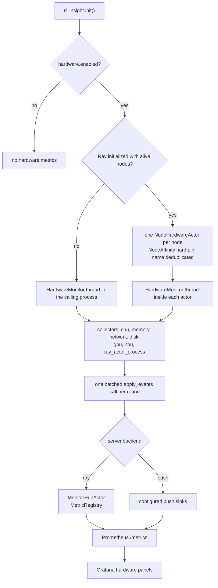

# Hardware Monitoring

Hardware metrics are collected by a background monitor that lives inside the training job itself, with no external exporter process or port to deploy: after `rl_insight.init()`, the monitor (one per node under Ray, otherwise a thread in the calling process) samples the node periodically and reports through the regular RL-Insight metric path.

## 1. Prerequisites

The system collectors (CPU, memory, network, disk) rely on psutil, which is already a dependency of RL-Insight. Vendor accelerators are optional:

| Accelerator | Requirement | Note |
|---|---|---|
| NVIDIA GPU | `pip install rl-insight[nvidia]` | Optional extra; installs `nvidia-ml-py` |
| Ascend NPU | `npu-smi` on `PATH` | Included with the Ascend driver |

Missing tooling never fails training: the collector is reported as unavailable through a status metric, and everything else keeps working.

## 2. Enable hardware monitoring

Hardware monitoring is enabled by default. Configure it through the `hardware` section of `rl_insight.init()`:

```python
import rl_insight

rl_insight.init(
    project="verl",
    experiment_name="ppo-run",
    config={
        "server": {"url": "http://<SERVER_IP>:18080"},
        "hardware": {
            "enabled": True,                # default; set False to disable
            "interval_seconds": 10,         # sampling interval, minimum 5
            "collectors": [                 # which collectors to run
                "cpu", "memory", "network", "disk", "gpu", "npu",
                "ray_actor_process",
            ],
            "disk_path": "/",               # filesystem measured by the disk collector
            "worker_role": "trainer",       # optional; role label of the reporting process
        },
    },
)
```

Notes:

- In a Ray job, `init()` creates one hardware actor per alive node, so host-level metrics are collected once per node even when several worker processes call `init()` themselves. Outside Ray, the monitor runs as a thread inside the calling process. Both modes choose their transport from `server.backend`: `ray` forwards to the job-level hub, and `push` writes directly to the configured sinks.
- The `self_process` collector is available but not in the default list; add it when worker processes call `init()` themselves and should report their own CPU/memory footprint. It describes the process hosting the monitor — under Ray that is the node-scoped hardware actor, not a training worker; use `ray_actor_process` for the per-worker view.
- The `ray_actor_process` collector is enabled by default: it reports the CPU/thread/memory footprint of every Ray actor of the current Ray job on the node under the `rlinsight_ray_process_*` families, labelled with its `pid` and an inferred `worker_role`. The Ray State API `list_actors` call is cluster-wide, so the query is filtered by the current `job_id`; workers of other jobs sharing the node are not attributed to this job and cannot pollute the `worker_role` / `device_index` dropdowns. The role comes from the actor's class name: `ActorRolloutRefWorker`/`CriticWorker` (non-colocated) and `FusedWorker_<roles>` map to the corresponding roles, whereas verl's default colocated workers share one anonymous `WorkerDict` class, which carries no role and is reported as `worker` — those processes are told apart by `pid`. The collector needs the Ray state API and reports itself unavailable outside a Ray job, so it is safe to leave in the default list.
- `ray_actor_process` also adds two labels that link these panels to the device panels: `local_rank`, taken from the actor name suffix `<Class>_<pg_idx>:<local_rank>` (the device ordinal inside the node), and `device_index`, read from `ASCEND_RT_VISIBLE_DEVICES` / `CUDA_VISIBLE_DEVICES` in the process environment and using the same card numbering as the NPU/GPU panels, so one dropdown can filter cards and processes together. When the value is a multi-card list, missing, or unparsable, the label is reported as an empty string rather than omitted — a metric family must keep a fixed label dimension, or the hub's Prometheus registry raises `DuplicateTimeseries` and drops batches as soon as workers with different label sets appear. rl-insight's own node-scoped actors (`MonitorHubActor`, `NodeHardwareActor`) are skipped so the monitor's own footprint is not counted as a training worker.
- `worker_role` is a **process-level** label: it describes the process that reported the sample, not the node. The process-level families (`rlinsight_ray_process_*` / `rlinsight_process_*`) always carry the key and use an empty value when the role is unknown; the `RL_INSIGHT_WORKER_ROLE` environment variable takes precedence over the config value. With `ray_actor_process` the label is inferred automatically from the Ray actor class name, so setting it by hand is only needed for the `self_process` collector.
- `interval_seconds` defaults to 10, which is a conservative value chosen to keep collection overhead low while still producing a usable time series; values below 5 are clamped to 5 with a `RuntimeWarning`. Section 5 covers the cost of each collector and how to measure it. Raise the interval on large clusters and lower it only when you need finer resolution.
- `disk_path` selects the filesystem whose utilization is reported (default `/`); point it at the training data or checkpoint directory when that mount is the one under pressure.
- The `RL_INSIGHT_HARDWARE_ENABLED` environment variable overrides `hardware.enabled` (`1/0`, `true/false`, `yes/no`, `on/off`, case-insensitive), and `RL_INSIGHT_WORKER_ROLE` overrides `hardware.worker_role`. Both are read only in the process that actually calls `init()`, and the resolved values are passed to the node actors as constructor parameters; the actors never re-read these variables.
  - **Outside Ray**: each process reads its own environment, so per-process enable/disable and roles work as expected.
  - **Under Ray**: the configuration is job-wide. The first process that calls `init()` and creates the node actors decides `enabled`, `interval_seconds`, `collectors`, and the `self_process` `worker_role`. Later `init()` calls from other workers only reuse the existing actors; their environment variables do not reconfigure them. To disable hardware monitoring for the whole job, set the variable in the first `init()` process (usually the driver) or at job-level `runtime_env.env_vars` — there is **no need to set it on every training node**; setting `RL_INSIGHT_HARDWARE_ENABLED=0` on only some training workers does not stop node actors that were already created.
  - Under Ray, `RL_INSIGHT_WORKER_ROLE` only affects the opt-in `self_process` collector (it measures the node actor itself). Per-training-worker roles are inferred by `ray_actor_process` from the actor class name and should not be set through each worker's environment.
  - Only the RL-Insight server URL is forwarded automatically through the hub actor's `runtime_env`; everything else travels through the merged config and actor constructor parameters.

## 3. Execution flow



- Under Ray, the monitor is created once per node in a `NodeHardwareActor` pinned with `NodeAffinitySchedulingStrategy(soft=False)` and named `RLInsightHardware_{run_id}_{node_id}`. Concurrent `init()` calls from several workers reuse the same actor, which is why hardware configuration is job-wide.
- Outside Ray (or when no alive node is visible), the monitor falls back to a daemon thread in the calling process.
- Each round collects every available collector, queues the samples as gauge events, and calls `client.apply_events(batch)` once. The Ray backend forwards that batch to the job's `MonitorHubActor`; the push backend writes it to the configured sinks.
- Prometheus scrapes the hub's `/metrics` endpoint, and the trainer dashboards read only these in-process series.

## 4. Metrics

All metrics are Prometheus gauges named with the `rlinsight_` prefix (exposed with the RL-Insight metric namespace, e.g. `rl_insight_monitor_rlinsight_cpu_utilization_percent`). Rates are computed from monotonic counters and reported per second.

| Family | Metrics |
|---|---|
| CPU | `rlinsight_cpu_utilization_percent`, `rlinsight_cpu_logical_count`, `rlinsight_cpu_physical_count`, `rlinsight_cpu_cgroup_throttled_periods`, `rlinsight_cpu_cgroup_throttled_seconds` |
| Memory | `rlinsight_memory_used_bytes`, `rlinsight_memory_available_bytes`, `rlinsight_memory_utilization_percent`, `rlinsight_memory_cgroup_limit_bytes`, `rlinsight_memory_cgroup_usage_bytes` |
| Network | `rlinsight_network_receive_bytes_per_second`, `rlinsight_network_transmit_bytes_per_second` |
| Disk | `rlinsight_disk_read_bytes_per_second`, `rlinsight_disk_write_bytes_per_second`, `rlinsight_disk_utilization_percent` |
| Ray actor process | `rlinsight_ray_process_cpu_percent`, `rlinsight_ray_process_thread_count`, `rlinsight_ray_process_rss_bytes` |
| Self process | `rlinsight_process_cpu_percent`, `rlinsight_process_thread_count`, `rlinsight_process_rss_bytes`, `rlinsight_process_rss_percent` |
| NVIDIA GPU | `rlinsight_gpu_utilization_percent`, `rlinsight_gpu_memory_used_bytes`, `rlinsight_gpu_memory_total_bytes`, `rlinsight_gpu_memory_utilization_percent`, `rlinsight_gpu_temperature_celsius`, `rlinsight_gpu_power_watts`, `rlinsight_gpu_info` |
| Ascend NPU | `rlinsight_npu_utilization_percent`, `rlinsight_npu_memory_used_bytes`, `rlinsight_npu_memory_total_bytes`, `rlinsight_npu_memory_utilization_percent`, `rlinsight_npu_temperature_celsius`, `rlinsight_npu_power_watts`, `rlinsight_npu_health_status`, `rlinsight_npu_hbm_bandwidth_utilization_percent`, `rlinsight_npu_info` |
| Diagnostics | `rlinsight_hardware_collector_available`, `rlinsight_hardware_collector_duration_seconds` |

Stable labels: `project`, `experiment_name`, `run_id`, `node`; device metrics additionally carry `device_vendor` and `device_index`. The two process families have different label contracts:

- `rlinsight_ray_process_*` (`ray_actor_process`, enabled by default) always carries `pid`, `worker_role`, `local_rank` and `device_index`. `worker_role` is inferred from the Ray actor class name, `local_rank` comes from the `<pg_idx>:<local_rank>` suffix of the actor name, and `device_index` comes from `ASCEND_RT_VISIBLE_DEVICES` / `CUDA_VISIBLE_DEVICES` in that process environment; unknown values are empty strings.
- `rlinsight_process_*` (`self_process`, not enabled by default) always carries `pid` and `worker_role`, and does **not** have `local_rank` or `device_index`. It describes the process hosting the monitor itself — the `NodeHardwareActor` under Ray, or the process that called `init()` outside Ray — so it has no worker-level local rank, and its environment does not represent a training worker's device binding. Filtering this family by `device_index` or `local_rank` returns no data. `worker_role` must be configured manually or supplied through `RL_INSIGHT_WORKER_ROLE`.

Every other family is node-level. On device metrics `device_index` is the physical card number (`npu-smi` numbering for NPU, NVML for GPU); on `ray_actor_process` it is the same physical card number assigned to that process, so both kinds of series can be filtered by one shared `device_index` value. Device metrics are emitted per logical device/chip. NPU series are scoped to `ASCEND_RT_VISIBLE_DEVICES` and GPU series to `CUDA_VISIBLE_DEVICES` when it lists plain integer indexes, so a job pinned to a subset only reports the cards it uses; non-integer forms (PCI bus ids, GPU UUIDs, MIG ids) cannot be mapped onto NVML indexes and leave every GPU of the node visible. The `*_info` metrics are constant 1 gauges carrying the device name and driver version as labels. `rlinsight_disk_utilization_percent` carries the configured `disk_path` as a `path` label. Cgroup metrics appear only when the runtime exposes container limits: the two `rlinsight_cpu_cgroup_throttled_*` metrics are cumulative since the container started, so derive rates with `rate()` in PromQL.

## 5. Collection cost and interval

`interval_seconds` is configurable per job (default `10`, minimum `5`). The per-collector duration is exported as `rlinsight_hardware_collector_duration_seconds{collector="..."}`, so the actual cost can be measured on a real cluster instead of estimated:

```promql
max by (collector) (rl_insight_monitor_rlinsight_hardware_collector_duration_seconds)
```

Typical costs per round:

| Collector | Cost |
|---|---|
| cpu, memory, network, disk | A few psutil calls in-process; no subprocesses. |
| `gpu` | One NVML query set per visible GPU; in-process, no subprocesses. |
| `npu` | The static mapping (`npu-smi info -m`, `npu-smi -v`) is queried once and cached. Every round then issues four targeted subprocess calls per visible chip: `npu-smi info -t usages`, `-t temp`, `-t power`, and `-t health`. Each call has a 2s timeout, and the whole round shares a 5s budget; if the budget is exhausted the remaining chips are skipped for that round and a warning is logged. |
| `ray_actor_process` | One Ray State API `list_actors` query per round, filtered by the current job and node. This is usually the dominant cost on clusters with thousands of actors. |

Guidance:

- Keep the default `10` for typical jobs; it matches the default Prometheus scrape interval, so gauge samples are not overwritten before they are scraped.
- On an 8-card NPU node every round spawns 32 short `npu-smi` processes. Use `interval_seconds: 30` or `60` when that process churn is measurable, and check the duration metric before lowering the interval.
- On large clusters, raise the interval to keep the State API query rate bounded; the `ray_actor_process` series is only refreshed once per round.
- Values below `5` are clamped to `5` with a `RuntimeWarning`.

## 6. View in Grafana

Hardware metrics show up in the hardware metric row of the trainer dashboards (e.g. `verl_trainer_v1_with_vllm_engine`) — no separate dashboard or exporter deployment is needed. Every hardware panel reads the in-process series only; there is no exporter fallback or second query. Device series keep the `NPU {{id}}` / `GPU {{id}}` legends, with `device_index` rewritten into the `id` label. Health (`1` healthy / `0` unhealthy) and HBM bandwidth utilization are collected through targeted `npu-smi` queries, so every panel is backed by the built-in collector. The dashboard has no NPU network throughput panel: `npu-smi` does not expose network-port RX/TX rates; that data requires the separate `hccn_tool`.

The host panels (CPU, memory, network, disk) are titled with a `Node` prefix: their values cover every process on the node rather than just this training job, so do not read them as per-job resource usage on a shared node.

The `Ray Actor Process CPU` / `Ray Actor Process Memory` panels are process-level, with the legend `{{node}} {{device_index}} {{worker_role}} {{pid}}`: they cover every Ray worker on the node through the `ray_actor_process` collector, which is on by default. The `Self Process CPU` / `Self Process Memory` panels cover the process running the monitor itself, with the legend `{{node}} {{worker_role}} {{pid}}`, and only draw data once `self_process` is enabled. The `hardware: Worker Role` variable filters by role, and the `hardware: Device` variable filters by `device_index` using the same condition as the in-process NPU/GPU panels — selecting a card narrows the process panels and the device panels together (CPU-pool processes without a card label drop out; pick `All` to restore the full set).

Multi-node layouts use the in-process `node` label as the only machine dimension. Legends (`{{node}} NPU {{id}}`) never collide across nodes. Node switching goes through the `hardware: Node` picker at the top (`node` label); `All` aggregates every node and a multi-selection keeps only the chosen ones. The `CPU / Host Metrics` and `Ascend NPU Metrics` rows **do not repeat into per-node tabs**: a row repeat requires the variable to resolve while the dashboard loads, but this variable comes from an instant query (evaluated at the end of the time range), so a finished run resolves it to nothing and the whole row collapses into one empty tab that renders no panels; a 1024-card cluster would also spawn hundreds of tabs. Both rows therefore always render flat and the node filter lives in the panel queries (`node=~"$node"`, degrading to match-all when the variable is empty). On a single-node run the variable has one value, so the same filter applies. Only the two `Ray Actor Process` legends sort by `Max` descending; every other hardware panel keeps its natural series order, so the NPU/GPU panels stay in rank order (`NPU 0`, `NPU 1`, ...).

The `Ascend NPU Metrics` and `NVIDIA GPU Metrics` rows **always render** and take no part in row-level visibility. Row visibility depends on a variable resolved when the dashboard loads, and the instant query that probes vendor identity resolves to nothing once the data goes stale: a finished run blanks the whole row, panels and all, and moving the time range back onto the run does not bring it back. Both rows therefore render unconditionally; a vendor with no data on this node reports `No data` per panel, so an NPU-only host shows an empty NVIDIA GPU row and vice versa.

## 7. Troubleshooting

A collector reports 0 in `rlinsight_hardware_collector_available`:

- `gpu` = 0: `nvidia-ml-py` is not installed (`pip install rl-insight[nvidia]`) or no NVIDIA driver/devices are visible.
- `npu` = 0: `npu-smi` is not on `PATH`. Inside training containers, the Ascend driver usually needs to be present; mount the host binary if it is missing:

```bash
docker run ... -v /usr/local/sbin/npu-smi:/usr/local/sbin/npu-smi ...
```

- A collector reports 1 but its panels are empty: `rlinsight_hardware_collector_available` reports whether the collector set up its tooling, not whether the node has devices. An installed `npu-smi` that reports no cards (or whose `info -m` mapping query fails) still shows `npu` = 1 with empty panels; the same applies to `gpu`.
- NPU panels are partial or a log says the sampling round exceeded its budget: the node has more chips than four `npu-smi` queries per chip can cover in 5 seconds. Raise `interval_seconds`, and check `rlinsight_hardware_collector_duration_seconds{collector="npu"}` to see the actual cost.
- Host-level series look duplicated or missing on multi-node Ray clusters: check that all nodes can reach the RL-Insight server and that the nodes list is healthy (`ray.nodes()`).
- Batches dropped because the transport failed are logged with `failed to forward ... hardware events; dropping them` on the reporter side; there is no dropped-events metric, because the transport that would carry it is the one that just failed. Check the RL-Insight server status when these warnings appear.
